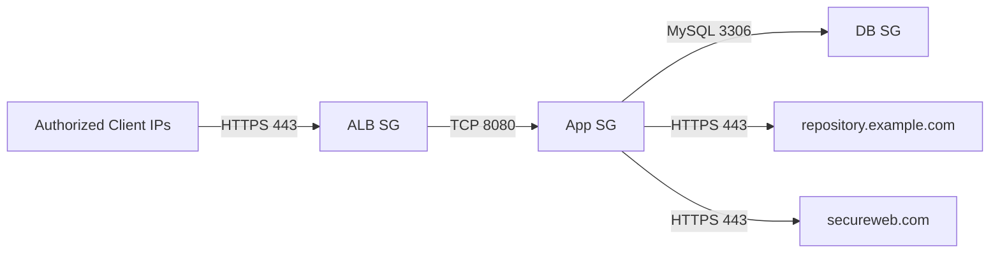

# terraform-task

## POC Infrastructure Diagram

```text
Internet (Authorized Client IPs)
    ↓ HTTPS:443
┌──────────────────────────────┐
│ ALB (Public Subnet)          │
│ 10.0.1.0/24                  │
└───────────────┬──────────────┘
                ↓ HTTP:8080 (ALB SG → App SG only)
┌──────────────────────────────┐
│ App EC2/ASG (Private Subnet) │
│ 10.0.10.0/24                 │
└───────────────┬──────────────┘
                ↓ MySQL:3306 (App SG → DB SG only)
┌──────────────────────────────┐
│ DB EC2 MySQL (Private Subnet)│
│ 10.0.20.0/24                 │
└──────────────────────────────┘

Outbound from App:
- HTTPS 443 to repository.example.com (bootstrap package)
- HTTPS 443 to secureweb.com
```

## Security Group Inbound/Outbound Chart



### Notes

- Arrow direction is **Source -> Destination**.
- Keep ALB source IPs restricted to authorized client ranges.
- Keep App external access limited to required HTTPS destinations.
