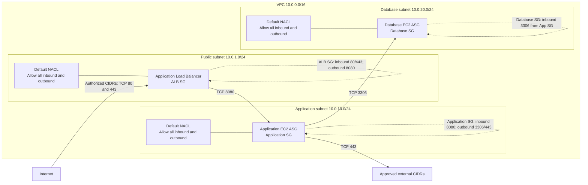

# Network ACL and Security Group Reference

This document describes the network traffic controls used by the Terraform environments.

## Network and security flow

The default NACL provides no traffic restrictions because it allows all traffic. The security groups provide the application-level access control between the ALB, application EC2 instances, and database EC2 instance.

## Network ACLs

### Attachments

The Terraform configuration does not create a custom network ACL. AWS automatically provides a default NACL for each VPC, and AWS associates it with new subnets that do not have another NACL explicitly selected.

| NACL | Attached subnet | Subnet CIDR | Connected resource |
|---|---|---|---|
| VPC default NACL | Public subnet | `10.0.1.0/24` | Application Load Balancer |
| VPC default NACL | Application subnet | `10.0.10.0/24` | Application EC2 ASG |
| VPC default NACL | Database subnet | `10.0.20.0/24` | Database EC2 ASG |

### Inbound rules

| Rule number | Protocol | Port range | Source | Action |
|---:|---|---:|---|---|
| 100 | All | All | `0.0.0.0/0` | Allow |
| `*` | All | All | `0.0.0.0/0` | Deny |

### Outbound rules

| Rule number | Protocol | Port range | Destination | Action |
|---:|---|---:|---|---|
| 100 | All | All | `0.0.0.0/0` | Allow |
| `*` | All | All | `0.0.0.0/0` | Deny |

The default NACL permits all IPv4 traffic at both the subnet boundary and the subnet route level. It is stateless, so responses must be allowed by their corresponding inbound or outbound rule.

## Security Groups

Security groups are stateful: a response to an allowed request is allowed automatically.

### Attachments

| Security group | Role | Attached resource | Subnet |
|---|---|---|---|
| ALB security group (`alb`) | Public listener traffic | Application Load Balancer | Public subnet: `10.0.1.0/24` |
| Application security group (`app`) | Application server traffic | Application EC2 ASG | Application subnet: `10.0.10.0/24` |
| Database security group (`db`) | Database server traffic | Database EC2 ASG | Database subnet: `10.0.20.0/24` |

### ALB security group inbound rules

| Protocol | Port | Source | Purpose |
|---|---:|---|---|
| TCP | 80 | CIDRs in `authorized_alb_cidrs` | Redirect HTTP to HTTPS |
| TCP | 443 | CIDRs in `authorized_alb_cidrs` | HTTPS application access |

The ALB terminates TLS using the ACM certificate. It forwards decrypted traffic to application instances over HTTP on TCP port 8080.

### Application security group inbound rules

| Protocol | Port | Source | Purpose |
|---|---:|---|---|
| TCP | 8080 | ALB security group (`alb`) | Application traffic from the ALB |

### Application security group outbound rules

| Environment | Protocol | Port | Destination | Purpose |
|---|---|---:|---|---|
| Development | UDP/TCP | 53 | `vpc_cidr` | DNS resolution through the VPC resolver |
| Development | TCP | 443 | `repository_egress_cidr` | HTTPS package repository access |
| Development | TCP | 443 | `secureweb_egress_cidr` | HTTPS external service access |
| Development | TCP | 3306 | Database security group (`db`) | MySQL access to database instances |

### ALB security group outbound rules

| Protocol | Port | Destination | Purpose |
|---|---:|---|---|
| TCP | 8080 | Application security group (`app`) | Send application traffic to EC2 instances |

### Database security group inbound rules

| Protocol | Port | Source | Purpose |
|---|---:|---|---|
| TCP | 3306 | Application security group (`app`) | Allow application servers to reach MySQL |

### Database security group outbound rules

| Protocol | Port | Destination | Purpose |
|---|---:|---|---|
| All | All | `0.0.0.0/0` | Allow all outbound traffic |

## Security notes

- Replace temporary `0.0.0.0/0` values with approved destination or source CIDRs before production use.
- Route tables control routing between subnets and networks, while NACLs and security groups control traffic filters.
- A custom NACL should be added to the VPC module if subnet-level deny rules or explicit rule ordering are required.
